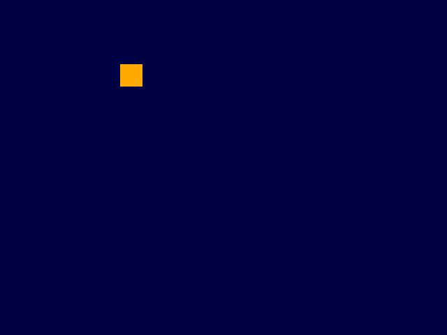
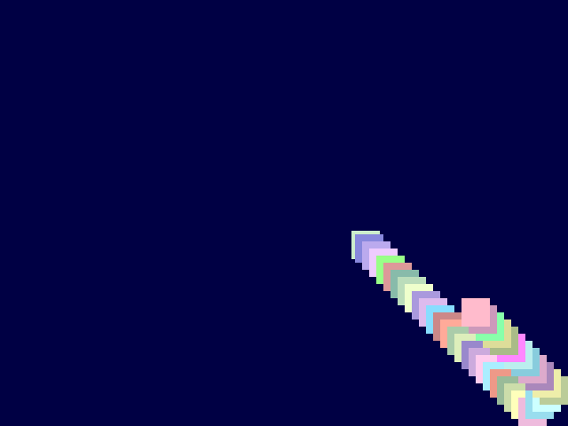
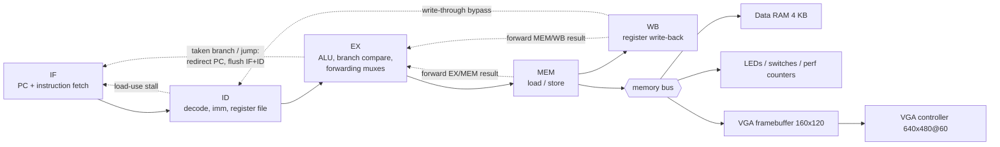

# RV32I 5-stage pipelined CPU with VGA output (Nexys A7)

[](https://github.com/NavinyaKalambhe/rv32i-pipelined-nexys-a7/actions)

A 5-stage pipelined implementation of the **RISC-V RV32I** base ISA in Verilog, running on a
Digilent **Nexys A7** (Artix-7) FPGA, with a memory-mapped **VGA framebuffer** that programs
running on the CPU draw into. A simple single-cycle core is included as the golden reference
for verification.

[▶ Watch the demo video](docs/testvid.mp4)

| Bouncing box (simulated) | Colour bars (simulated) | Paint trail (simulated) |
|---|---|---|
|  |  |  |

## Features
- All 37 RV32I instructions. `FENCE` executes as a NOP; `ECALL`/`EBREAK` make the core spin on the
  instruction (acts as halt). No CSRs, interrupts or M/C extensions.
- Classic 5-stage pipeline (IF, ID, EX, MEM, WB) with full **forwarding**, **load-use stall**,
  and **branch/jump flush** (resolved in EX, predict-not-taken, 2-cycle penalty).
- Byte/halfword/word loads and stores with byte strobes.
- 640x480 @ 60 Hz VGA: 160x120 12-bit framebuffer (dual-clock block RAM), CPU and pixel clocks independent.
- Memory-mapped LEDs, switches and **hardware performance counters** (cycles, instructions retired,
  stalls, taken branches) readable from software.
- Automated verification: directed hazard tests, **differential random testing against the
  single-cycle reference**, VGA timing/pixel checks, and CI on every push.

## Architecture


| Hazard | Handling |
|---|---|
| RAW, producer 1 or 2 instructions ahead | Forwarding from EX/MEM or MEM/WB into the ALU inputs |
| RAW, producer 3 instructions ahead | Register file write-through bypass |
| Load followed by dependent instruction | 1-cycle stall, then forward from MEM/WB |
| Taken branch / JAL / JALR | Resolved in EX, 2 wrong-path instructions flushed |
| Writes to `x0` | Never forwarded |

### Memory map
| Address | Description |
|---|---|
| `0x0000_0000` | Data RAM (4 KB). Instruction memory is a separate 4 KB ROM (Harvard) |
| `0x1000_0000` | LEDs (read/write) |
| `0x1000_0004` | Switches (read) |
| `0x1000_0008` | Cycle counter (read) |
| `0x1000_000C` | Instructions retired (read) |
| `0x1000_0010` | Load-use stall cycles (read) |
| `0x1000_0014` | Taken branches/jumps (read) |
| `0x2000_0000 + 4*(y*160+x)` | VGA framebuffer pixel, write-only, `sw` with `0x0RGB` |

## Verification
Run everything with `make test` (needs [Icarus Verilog](https://steveicarus.github.io/iverilog/);
`make mem random` also needs a RISC-V GCC, e.g. `gcc-riscv64-unknown-elf`).

| Test | What it checks |
|---|---|
| `tb_soc` | LED demo on both cores |
| `tb_prog` + `sw/hazard_test.S` | 24 directed tests: every forwarding path, load-use, flushes, x0, link registers, FENCE |
| `tb_prog` + `sw/full_test.S` | Broad instruction-set test (arithmetic, shifts, loads/stores, branches, jumps, LUI/AUIPC) |
| `tb_diff` + `scripts/gen_random_test.py` | Random programs run on the single-cycle reference and the pipeline; every register write and every store must match, in order |
| `tb_vga` | Framebuffer contents, HSYNC (32 us) and VSYNC (16.8 ms) timing; `+dump` writes a full frame |
| `tb_bounce` | Animation program: box position and erase after 3 frames |
| `tb_interactive` | Flips the switches and checks the screen: colours, speed, size, background, paint trail, horizontal sweep, LED mirror |

**Do the tests catch bugs?** Deliberately breaking the pipeline (removing the load-use stall, removing
each forwarding path, removing the flush, removing the register-file bypass, forwarding `x0`)
makes the directed hazard test fail for every one of these mutations; the random differential test
catches five of the six on the first seed, so both kinds of test are kept.

## Results
Measured in simulation (cycles per instruction):

| Program | Single-cycle CPI | Pipelined CPI |
|---|---|---|
| `full_test` (broad ISA test) | 1.00 | 1.23 |
| `hazard_test` (hazard-heavy by design) | 1.00 | 1.52 |
| 6 random programs | 1.00 | 1.21 to 1.28 |

The pipelined core runs at 50 MHz on the board (single-cycle was limited to 25 MHz), so it
executes roughly 1.6x more instructions per second than the single-cycle version at these CPIs.

Fill in after your own Vivado run (Reports > Report Utilization / Timing Summary):

| Metric | Value |
|---|---|
| LUTs / FFs / BRAM36 | 1838 |
| Worst setup slack @ 50 MHz | 6.903ns |
| Maximum clock frequency (WNS-based estimate) | 100MHz |

## Switch controls (default demo, `sw/interactive.S`)
| Switch | Function |
|---|---|
| SW0 / SW1 / SW2 | Box colour: blue / green / red (any mix; all off = automatic colours) |
| SW3 | Rainbow: automatic colour change every frame |
| SW4 to SW6 | Speed, 0 (slow) to 7 (fast) |
| SW7 | Move 2 pixels per frame instead of 1 |
| SW9 SW8 | Animation: `00` diagonal bounce, `01` horizontal sweep, `10` paint trail, `11` vertical sweep |
| SW10 | Background colour (dark blue / dark red) |
| SW11 | Box size 8 / 16 pixels |
| SW12 | Flick to reverse direction |
| SW15 | Pause movement (colour changes still apply) |

The LEDs mirror the switches.

## Build and run
**Simulation**
```
make mem random     # assemble programs (needs RISC-V GCC)
make test           # run all simulations
```
**Vivado (Nexys A7-100T or 50T)**
1. Open Vivado, then in the Tcl console: `cd <repo folder>` and `source create_project.tcl`
   (edit `part` inside for the 50T).
2. Choose the demo by editing `PROGRAM` in `rtl/top.v`: `interactive.mem` (default, switch-controlled),
   `bounce.mem`, `vga_demo.mem` (colour bars) or `program.mem` (LED demo).
3. Run Synthesis, Implementation, Generate Bitstream, then Program Device. Plug in a VGA monitor.

## Writing programs
`sw/build.sh mytest.S` assembles RV32I assembly into a `.mem` file. To draw a pixel:
`sw color, 4*(y*160+x)(base)` with `base = 0x20000000` and `color = 0x0RGB`.

## Repository layout
```
rtl/            core (riscv_pipe.v), reference core (riscv_single.v), alu, control, regfile,
                imm_gen, memories, vga_fb.v, soc.v, top.v
tb/             testbenches
sw/             assembly programs and their .mem images, build.sh
scripts/        random test generator, frame -> PNG converter
constraints/    Nexys A7 pin and clock constraints
docs/           pictures and the GitHub publishing checklist
```

## Possible next steps
Branch prediction, M extension (multiply/divide), a character display with font ROM, UART,
interrupts and CSRs, running the official riscv-arch-test suite.

## License
MIT, see `LICENSE`.
